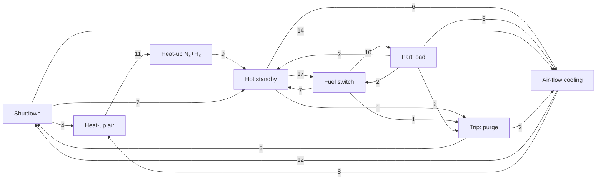

# Operational Modes — current (8 plant stages)

This page lists only the operational modes **in use today**: the eight plant stages decided on 2026-11-03. They are named after **what the plant is doing** (which supplies and devices are on), not after the stack temperature alone.

- Code: `03_data_analysis/scripts/plant_stages.py` (column `plant_stage`)
- Output: `03_data_analysis/plant_stages/` (1-min parquet, blocks, minutes per day, transitions)
- Notebook: `03_data_analysis/operating_states.ipynb` §12
- History, older 7-stage definitions, ramp rates and edge-mode identifiers: [[operational-modes]]

Tags: **[Fact]** = measured data · **[Rule]** = decided / specified · **[Inferred]** = interpretation.

---

## 1. The eight stages

| # | Stage | What the plant is doing | Detection rule (per minute) | Hours in data | Stack T (p5–p95) |
|---|---|---|---|---|---|
| 1 | **Heat-up air** | Start-up, cathode air only; the EAPH heats the air | old stage Start-up and gas phase *Air only* | 56 | 25–274 °C |
| 2 | **Heat-up N₂+H₂** | Start-up with forming gas on (stack above ~210 °C) | old stage Start-up and phase *Forming gas* or *N₂ purge* | 82 | 237–563 °C |
| 3 | **Hot standby** | Stack hot, forming gas, no load (includes the old Thermal adjustment) | old stage Hot standby or Thermal adjustment, plant not off | 338 | 506–612 °C |
| 4 | **Fuel switch** | Natural gas on, no current yet | phase *Natural gas*, string current < 1 A, not Shut-down | 3.3 | 577–652 °C |
| 5 | **Part load** | Stack current flowing | old stage Part load or Rated power (rated power never reached) | 4.5 | 596–666 °C |
| 6 | **Air-flow cooling** | Shut-down with cathode air still blowing | old stage Shut-down and air (`FIRC_111` + `FIRC_112`) > 20 ln/min | 255 | 31–574 °C |
| 7 | **Shutdown** | Everything off except control: air-off cooling, plant off (cold or warm), and an emergency stop until the air is back on | everything not matched above (Idle, at ambient, air-off cooling, emergency stop) | 174 | 6–199 °C |
| 8 | **Trip: purge** | Emergency purge after a safety cut: air, N₂, H₂ and control on, all else off | trip window from `industrial_stages.py`, cut is not an emergency stop | 1.3 | 629–691 °C |

Hours: 39 day files, 2025-10-30 → 2026-03-30; another 12.9 h are *No data*. **[Fact]**

- **[Rule]** Order of assignment in `base_stage()`: Shutdown is the default, then Heat-up, Hot standby, Air-flow cooling, Fuel switch and Part load overwrite it in that order; trip windows are applied last (`add_trips()`).
- **[Rule]** An **emergency stop** closes every supply, so it is filed as **Shutdown**, not Trip: purge. Once the air comes back on, the normal rules take over again.
- **[Rule]** Fuel switch and Part load use the same natural gas and the same hot stack; only the current differs (< 1 A vs 1–16 A). Part load was reached only via Fuel switch (10 of 10). **[Fact]**
- **[Rule, rule of thumb]** Forming gas is on ⇔ stack > 210 °C and no natural gas. It holds on **96.1 %** of minutes (`rule_210_check`), except right after an emergency stop. **[Fact]**
- In the 2D twin (`05_twin_2d/`) stage 8 is shown as **"Trip / Emergency purge"**.

### Thresholds

| Name in code | Value | Meaning |
|---|---|---|
| `AIR_COOL` | 20 ln/min | Above this (air blowers sum) a cool-down is forced by air → Air-flow cooling |
| `I_POWER` | 1 A | Below this string current, natural gas on = Fuel switch, not power |
| `T_FORMING` | 210 °C | Stack temperature above which forming gas is normally on |

## 2. Stage order

Transitions seen in the data (episode counts, `plant_stage_transitions.csv`). **[Fact]**

Full matrix (from → to):

| from \ to | Heat-up air | Heat-up N₂+H₂ | Hot standby | Fuel switch | Part load | Air-flow cooling | Shutdown | Trip: purge |
|---|---|---|---|---|---|---|---|---|
| Heat-up air | 0 | 11 | 0 | 0 | 0 | 1 | 2 | 0 |
| Heat-up N₂+H₂ | 1 | 0 | 9 | 0 | 0 | 1 | 3 | 0 |
| Hot standby | 0 | 0 | 0 | 17 | 0 | 6 | 1 | 1 |
| Fuel switch | 0 | 0 | 7 | 0 | 10 | 0 | 1 | 1 |
| Part load | 0 | 0 | 2 | 2 | 0 | 3 | 1 | 2 |
| Air-flow cooling | 8 | 1 | 0 | 0 | 0 | 0 | 12 | 2 |
| Shutdown | 4 | 2 | 7 | 0 | 0 | 14 | 0 | 0 |
| Trip: purge | 0 | 0 | 1 | 0 | 0 | 2 | 3 | 0 |

The main path is **Shutdown → Heat-up air → Heat-up N₂+H₂ → Hot standby → Fuel switch → Part load → (Hot standby or Air-flow cooling) → Shutdown**. Shutdown ↔ Air-flow cooling switch often (14 and 12), which fits the air being switched on and off during long cool-downs **[Inferred]**. Shutdown → Hot standby (7) is not explained yet.

## 3. Mapping to the old stages and edge modes

| Plant stage | Old stage(s) in `operating_states.py` | Edge mode in `edges/edges.yaml` |
|---|---|---|
| Heat-up air | Start-up | `startup` |
| Heat-up N₂+H₂ | Start-up | `startup` |
| Hot standby | Hot standby, Thermal adjustment | `normal_operation` **[Inferred]** |
| Fuel switch | Hot standby, Thermal adjustment | `normal_operation` **[Inferred]** |
| Part load | Part load (Rated power never reached) | `normal_operation` |
| Air-flow cooling | Shut-down | `normal_shutdown` |
| Shutdown | Shut-down, Idle, (aborted Start-up) | — (supplies closed); emergency stop → `emergency_shutdown` **[Inferred]** |
| Trip: purge | Thermal adjustment, Shut-down | `emergency_shutdown` **[Inferred]** |

The synthetic generator (`04_synthetic_data/`) still plans on the old 7 stages on purpose; `pattern_filler.py` adds the `plant_stage` column by look-up in `plant_stages_1min.parquet`.

## 4. Open points

1. 44 min of cold air before a heat-up are filed as Air-flow cooling.
2. Thermal adjustment is merged into Hot standby; not yet decided whether it should be a sub-step.
3. Heat-up is split by gas phase, not at a fixed 210 °C.
4. Rated power was never reached (max 33.6 kW, 18.8 A/string), so Part load covers all load operation.
