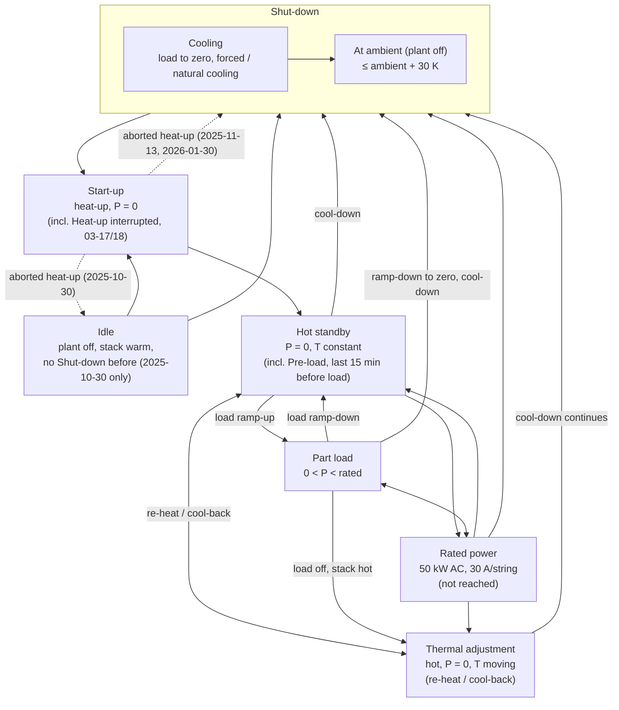
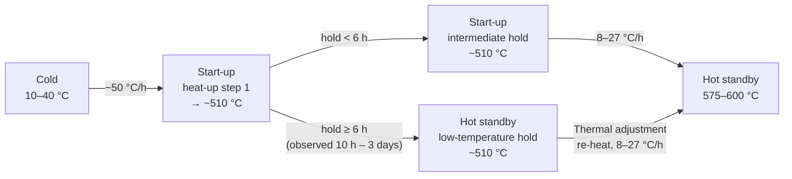
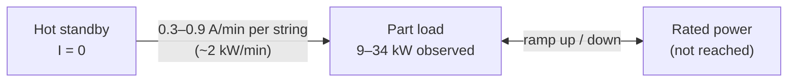
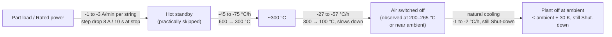

# Operational Modes

> Korean version: [[operational-modes_ko]]
>
> **Current modes:** the 8 plant stages in use since 2026-11-03 are on their own page, [[operational-modes-current]].

This page has two layers:

1. **Operating states** (§1–§4, added 2026-10-06): the five process states of the stack module — Start-up, Hot standby, Part load, Rated power, Shut-down — as defined by the user, plus two stages added for the data segmentation on 2026-10-14 (Thermal adjustment, Idle), with transition diagrams and data-derived ramp rates.
2. **Edge-attribute modes** (§5, user-confirmed 2026-05-26): the five canonical identifiers used in `edges/edges.yaml` (`active_modes`, `triggers_mode`). **These identifiers are unchanged**; §5.1 maps the operating states onto them.

Tags: **[Fact]** = measured data · **[Rule]** = Elcogen / Design Doc / IKTS specification · **[Inferred]** = interpretation.

---

## 1. Operating state definitions

User-defined 2026-10-06.

| State | Definition | Stack power | Stack temperature | Data detection criterion |
|---|---|---|---|---|
| **Start-up** | The stage from room temperature until the stack reaches sufficient temperature and is ready to produce power, i.e. until **Hot standby** is reached. Only follows a Shut-down (or Idle). A heat-up stopped and resumed after the plant was off is one Start-up (*Heat-up interrupted (plant off)*, 2026-03-17/18) | 0 | Rising: ambient → operating window | I = 0, dT/dt > +10 °C/h, stack not yet hot since the last Shut-down |
| **Hot standby** | The stack produces no power and its temperature is held **constant**: it neither rises nor falls. Part load only follows Hot standby: the last 15 min before load are Hot standby *Pre-load (ready for load)* even when the temperature still moves | 0 | Constant | I < 1 A, \|dT/dt\| < 5 °C/h (20-min rate), and either T ≥ 550 °C, or 450–550 °C held for ≥ 6 h (low-temperature hold, §4.3) |
| **Thermal adjustment** (added 2026-10-14) | A hot stack with no load whose temperature is being changed: *Re-heat* (rise; incl. *Re-heat to operating temperature* from the ~510 °C hold, *Re-heat to hold*) or *Cool-back* (fall that levels off in a hold or is followed by load; incl. *Temperature dip during hold*) | 0 | Rising or falling within the hot range | I < 1 A, T > 450 °C, \|dT/dt\| ≥ 5 °C/h, after the stack has been hot (Hot standby or load) |
| **Rated power** | Operation at the stack module's defined rated condition | Rated: 50 kW AC / 60 kW DC, 30 A per string | Operating window | I ≈ 30 A per string |
| **Part load** | Operation at a power lower than rated power | 0 < P < rated | Operating window | 1 A ≤ I < 30 A per string |
| **Shut-down** | Transition from Rated power or Part load to Hot standby, then cooling down to room temperature. Two sub-names (`sub_stage`): **Cooling** (load to zero, forced cooling, natural cooling while the stack is still warm) and **At ambient (plant off)** (stack within 30 K of ambient, waiting for the next Start-up) | Decreasing → 0 | Falling: operating → ambient | I → 0, then dT/dt < -10 °C/h, or cooling with air flow on, or a hot stack falling at ≥ 5 °C/h with no load; continues after the air is switched off (natural cooling); once the stack is near ambient (T ≤ ambient + 30 K) with the plant off, it stays Shut-down (plant off at ambient) until a new Start-up begins |
| **Idle** (added for data segmentation, not a process state) | The plant is off but the stack is still warm, and no Shut-down comes before it: the first file (2025-10-30) or cooling after a heat-up that stopped below Hot standby | 0 | Warm, drifting slowly (typically -1 to -2 °C/h) | I < 1 A, EAPH off, air off, \|dT/dt\| < 10 °C/h, T > ambient + 30 K, no Shut-down before it |

- **[Rule, user decision 2026-10-14]** A steady hold at 450–550 °C that lasts **≥ 6 h** is **Hot standby (low-temperature hold)**, not Start-up. A shorter hold stays the Start-up intermediate hold. The 550 °C split and the 6 h minimum were set for the data segmentation (`03_data_analysis/scripts/operating_states.py`).
- **[Rule, user decision 2026-10-14, later; the rise/fall labels were replaced by Thermal adjustment in the next rule]** **Hot standby is a constant temperature only.** Any no-load minute where a hot stack's temperature rises or falls (|dT/dt| ≥ 5 °C/h, the same tolerance as before) is not Hot standby. A **rise** is **Start-up**, operation *Re-heat (no load)*, *Re-heat to operating temperature* (from the ~510 °C hold) or *Re-heat to hold*. A **fall** is **Shut-down**, operation *Cool-down to Hot standby* (the cool-back levels off in a hold or load follows) or *Temperature dip during hold*. This replaces the earlier rule that re-heats and cool-backs stayed inside Hot standby. So Hot standby can now be left for Start-up (re-heat) and entered from Shut-down (cool-back), and a re-heat or cool-back may sit directly between two load periods. Effect on the 39 days: Hot standby 349 h → 296 h; about 33 h moved to Start-up and about 20 h to Shut-down.
- **[Rule, user decision 2026-10-14, latest]** **Thermal adjustment replaces the re-heat / cool-back labels.** Technically a Start-up can only begin from a Shut-down, and Part load can only begin from Hot standby. The previous rule produced Hot standby → Start-up (8), Part load → Start-up (2) and Shut-down → Part load (2); all were no-load temperature changes of a hot stack. They are now the stage **Thermal adjustment** (18 episodes, 45 h). A cool-back that runs straight into a cool-down is the start of that Shut-down; the load ramp-down before a Thermal adjustment stays Part load. Idle is kept; only the 2026-03-17/18 overnight pause became part of the Start-up, so Idle → Start-up is left once (2025-10-30, first file). Allowed new arrows: Hot standby ↔ Thermal adjustment, Part load / Rated power → Thermal adjustment, Thermal adjustment → Shut-down. Shut-down carries the sub-names Cooling and At ambient (plant off).
- **[Rule, user decision 2026-10-14, final]** **The 2026-03-17/18 overnight pause stays Start-up.** The plant is off 17 Mar 20:08 → 18 Mar 07:10 (188 → 167 °C, about -2 °C/h) between two parts of one heat-up; the user confirmed it is Start-up, operation *Heat-up interrupted (plant off)*, not Idle and not Shut-down.
- **[Rule, user decision 2026-10-14, revised same day]** **Shut-down vs Idle.** Shut-down has three parts: **forced cooling** (air flow on, stack inlet pressure `PIR_2_02` > 1), **natural cooling** once the air is switched off (air off, heater off, typically -1 to -2 °C/h), and **plant off at ambient**: any minute with the plant off (no current, heater off, air off) and the stack within **30 K of ambient** is Shut-down, whatever came before, until a new Start-up begins. There is no separate Cold stage. **Idle** is a warm stack (more than 30 K above ambient) with the plant off and no Shut-down before it (only 2025-10-30: the first file, and after a heat-up that stopped at ~215 °C). The 2026-03-17/18 overnight pause after a heat-up to ~190 °C is part of the Start-up, not Idle (rule above). Ambient is not measured directly: the median of the fuel-module supply-line probes `TIR_1_1_1`, `TIR_1_2_1`, `TIR_1_3`, `TIR_1_4_1` (60-min rolling median, typically 10–18 °C) is used as the proxy, so the threshold is about 40–48 °C. A Shut-down tail is followed across missing day files (up to 7 days back). The 30 K margin replaces the earlier fixed 50 °C end point and was set for the data segmentation.
- **[Rule, user decision 2026-10-15]** **The gas and air sensors label sub-phases and fix wrong blocks; the six stages and the stage map stay.** Stack temperature, string current, EAPH power, stack inlet pressure and the ambient probes still decide the stage. Every minute also gets a **`phase`** from the flow controllers (`03_data_analysis/scripts/operating_states.py` `gas_phase`): **Natural gas** (`FIRC_12` > 20 ln/min, or load), **Forming gas (N2 + H2)** (`FIRC_13` > 100 and `FIRC_15` > 5), **N2 purge** (N2 only), **Air only** (blowers `FIRC_111`+`FIRC_112` > 100 or `PIR_2_02` > 1), **Plant off**. Supply gaps of up to 10 min inside forming gas or natural gas are bridged, and any state shorter than 3 min takes its neighbours' state. Three label changes follow: (1) **Pre-load** is the no-load natural-gas time that runs straight into load (5–20 min in the data), not a fixed 15 min; the fixed 15 min is kept only when no natural gas comes before the load. (2) Natural gas on with no load following, in Hot standby or Thermal adjustment, is operation **Fuel switch-over (NG on, no load)** inside that stage (2026-03-04, 03-19, 03-30 and the switch back after load). (3) **EAPH power with the blowers off is not a heat-up.** 2026-02-06 13:27 → 24:00 (about 0.4 kW, no air, no gas, stack ≈ 45 °C) is no longer a Start-up: it is Shut-down *At ambient (plant off)*, operation **Heater on without air (false start)**. What the phases show: every cold Start-up heats in air first and switches forming gas on at about 190–240 °C (274 °C on the warm start of 2026-03-22); Shut-down keeps forming gas on down to about 210–290 °C, then cools in air only (2026-03-25 kept it to 69 °C, then N2 purge for 2.6 h); Part load always runs on natural gas. `03_data_analysis/scripts/flow_check.py` checks these (§5.2 lines).
- **[Rule]** Operating window: stack inlet 580 °C + ΔT ≤ 100 K (target ≤ 680 °C); maximum allowed stack temperature 720 °C. Source: IKTS Commissioning Overview p.20, p.25.
- **[Rule]** Rated condition: 20 × Elcogen E3000 (5 strings × 4 stacks); nominal 30 A per string, 150 A for the system. Source: Elcogen manual p.14, p.17, p.18, p.21; `_config/operating_limits.yaml`.

## 2. State transition diagram

Final stage map (2026-10-14). Solid arrows are the allowed transitions (`03_data_analysis/scripts/flow_check.py` `ALLOWED`, `04_synthetic_data/build_library.py` `DESIGN`); dotted arrows were seen in the data but are outside the design.



Hot standby is a constant temperature only (§1): every no-load rise or fall of a hot stack is **Thermal adjustment**. Start-up only follows a Shut-down (or Idle on 2025-10-30) and Part load only follows Hot standby (the last 15 min before load are Hot standby *Pre-load*). Shut-down carries the sub-names Cooling and At ambient (plant off). Observed in the library (39 days, 90 episodes): Shut-down → Start-up 10, Start-up → Hot standby 10, Hot standby → Thermal adjustment 11, Thermal adjustment → Hot standby 16, Hot standby → Part load 10, Part load → Thermal adjustment 7, Hot standby → Shut-down 4, Part load → Shut-down 3, Thermal adjustment → Shut-down 2, Idle → Start-up 1; outside the design: Start-up → Shut-down 2, Start-up → Idle 1.

## 3. Flow within each state (with measured values)

### 3.1 Start-up

**[Fact]** In the data, heat-up ran in two steps with a hold at ~510 °C in between.

**[Rule, user decision 2026-10-14]** A hold of ≥ 6 h ends Start-up: the stack is then in Hot standby (low-temperature hold). The second step to 575–600 °C is **Thermal adjustment (re-heat to operating temperature)**, because Hot standby is a constant temperature only and a Start-up only follows a Shut-down (§1). A hold shorter than 6 h stays inside Start-up.



### 3.2 Hot standby → load operation



### 3.3 Shut-down



- **[Fact]** In the data the air was switched off while the stack was still warm: 2026-01-30 at 197 °C, 02-17 at 210 °C and 03-30 at 264 °C. The stack then cooled naturally at about -1.7 °C/h (median) for many hours. On 2025-11-18, 2026-02-06 and 03-26 the air stayed on until the stack was at 25–46 °C.
- **[Rule, user decision 2026-10-14]** All three parts are Shut-down; the stage ends only when a new Start-up begins (§1).

## 4. Data-derived ramp rates

### 4.1 Method

- **Data:** `02_data/downsampled/*_10s.parquet`, 39 days (2025-10-30 to 2026-03-30).
- **Stack temperature:** median of the 36 stack-module thermocouples `TIR_4_6_*`, resampled to 1 min. Rates are 1-hour centred differences. Sensor positions are 3 cm from the cathode inlet/outlet (IKTS p.5).
- **Current:** string current = Σ `EIRC_41…45_CurrentMon` / 5. This signal is populated only from 2026-03-17.
- **Power:** Σ `EIRC_4X_Actual_Power`. Values above 200 kW (e.g. 3e37 on 2026-03-20) are excluded as glitches.
- **Band rates:** time between the first upward crossings (heat-up) or the last downward crossings (cool-down) of each 100 °C band.

### 4.2 Start-up heat-up rate — limit **120 °C/h** [Rule, Elcogen p.18, p.20–21]

| Campaign (start) | 100→200 | 200→300 | 300→400 | 400→500 | Median / p95 during heat-up (°C/h) |
|---|---|---|---|---|---|
| 2025-11-13 | 36 | 36 | 76 | – | 51 / 92 |
| 2026-02-13 | 51 | 55 | 57 | 18 | 50 / 57 |
| 2026-03-01 | 50 | 55 | 56 | 17 | 42 / 56 |
| 2026-03-12 | 50 | 55 | 57 | 51 | 44 / 57 |
| 2026-03-17 | 49 | (plant off overnight, *Heat-up interrupted*) | 66 | 53 | 34 / 73 |
| 2026-03-28 | 50 | 55 | 56 | 18 | 44 / 56 |

- **[Fact]** From February onwards, heat-up was consistent at **~50–56 °C/h**, below half of the 120 °C/h limit.
- **[Inferred]** The ramp setpoint is approximately 50 K/h.
- **[Fact]** The second step, from ~510 °C to the 575–600 °C level (520→570 °C), ran at **8–27 °C/h** (03-03: 11, 03-18: 12, 03-23: 8, 03-29: 27). After a hold of ≥ 6 h (03-03, 03-29) this step is a Thermal adjustment re-heat that follows a Hot standby hold (§3.1).
- **[Fact]** The first campaign (2025-11-13) reached p95 92 °C/h on the median and **108 °C/h on the hottest thermocouple**, close to the 120 °C/h limit.

### 4.3 Hot standby — observed segments

Detection criterion: I < 1 A, |dT/dt| < 5 °C/h, and either T ≥ 550 °C, or 450–550 °C held for ≥ 6 h (changed 2026-10-14; was T > 450 °C for ≥ 1 h). Only the constant-temperature hold counts (2026-10-14, later): re-heats, drift and cool-backs between holds are Thermal adjustment (§1). Within the remaining holds the temperature changes at a median of 0.2 °C/h.

| Level | Periods | Duration | Followed by load? |
|---|---|---|---|
| **~510 °C** | 01-31→02-02, 02-02→02-04, 02-14→02-16, 03-01→03-03, 03-29 | 10–55 h | No (except 03-29, which then rose to 590 °C) |
| **575–610 °C** | 03-18→19, 03-23→24, 03-24→25, 03-29→30 | 12–16 h | **Yes** — immediately before load |

- **[Inferred]** The **575–600 °C plateau** fits the user definition ("ready to produce power").
- **[Rule, user decision 2026-10-14]** The **~510 °C plateau** is **Hot standby (low-temperature hold)** when it lasts ≥ 6 h. The stack is parked hot with the EAPH trimming at ~9–10 kW, air on and no load, for 1.7–3 days. Two of these holds ended in a cool-down without ever reaching 575 °C, so they are not a step of a start-up. Its purpose is still not confirmed (see §6).
- **[Fact]** Under this rule the segmentation finds three multi-day holds: 2026-01-31 21:56 → 02-04 02:01 (76 h; the 1 h dip to 491 °C on 02-02 and the climb back are Thermal adjustment, §1), 02-14 02:58 → 02-16 10:37 (56 h) and 03-01 21:43 → 03-03 14:33 (41 h). The table above lists the 01-31 → 02-04 hold as two periods split at that dip.

### 4.4 Load ramp-up / ramp-down — limit **1 A/min per stack** [Rule, Elcogen p.14, p.17–18, p.21]

| Date | Max current / power | Ramp-up A/min/string (median / p95 / max) | Ramp-down A/min/string (median / p5) | Power ramp kW/min (up p95 / down p5) |
|---|---|---|---|---|
| 2026-03-19 | 9.1 A / 21 kW | 0.46 / 0.89 / 0.92 | -1.15 / -2.06 | +2.1 / -4.8 |
| 2026-03-20 | 18.8 A / – | 0.08 / 0.15 / 0.15 | -0.07 / -0.13 | – |
| 2026-03-24 | 14.6 A / 31 kW | 0.29 / 0.88 / 0.91 | -0.19 / -3.27 | +1.8 / -7.4 |
| 2026-03-25 | 16.2 A / 34 kW | 0.40 / 0.86 / 0.92 | -1.82 / -3.06 | +1.8 / -6.2 |
| 2026-03-30 | 3.8 A / 9 kW | 0.18 / 0.19 / 0.19 | -0.33 / -0.92 | +0.5 / -2.2 |

Rates use a 4-minute centred difference on 1-min data, counting only |dI/dt| > 0.05 A/min.

- **[Fact]** The ramp-up ceiling is **~0.9 A/min per string**, just below the 1 A/min limit.
- **[Fact]** On 2026-03-30 (11th heat-up) the ramp was 0.19 A/min, matching IKTS's 0.2 A/min (IKTS p.9, p.26).
- **[Fact]** Ramp-down is 2–4× faster than ramp-up.
- **[Fact]** At stop (03-24 09:26, 03-25 15:15) there were step drops of **8 A within 10 s**. This exceeds 1 A/min.
- **[Inferred]** These step drops are a stop or trip, not a controlled ramp-down. Not yet verified.
- **[Fact]** The controller setpoint `EIRC_4X_SP_SlewRateAbs` is 0 over the whole period, so the ramp setting cannot be read from the data.

### 4.5 Shut-down cool-down rate — limit **120 °C/h** [Rule]

Values in °C/h, measured on the final cool-down of each campaign.

| Campaign (cool-down date) | 600→500 | 500→400 | 400→300 | 300→200 | 200→100 |
|---|---|---|---|---|---|
| 2025-11-13 (11-14→17) | – | – | -7 | -5 | -6 |
| 2026-01-30 (02-04→05) | – | -25 | -19 | -12 | -6 |
| 2026-03-01 (03-04) | -54 | -50 | – | – | – |
| 2026-03-17 (03-20) | – | -63 | -37 | – | – |
| 2026-03-23 (03-25→26) | -63 | -57 | -47 | -57 | -27 |
| 2026-03-28 (03-30) | -73 | -61 | -44 | – | – |

"–" means the data ends or the band was not crossed monotonically.

- **[Fact]** Early campaigns (November, February) cooled at **-5 to -25 °C/h**, close to natural cooling.
- **[Fact]** From March onwards, cooling was **-45 to -75 °C/h** (instantaneous minimum -86 °C/h), within the 120 °C/h limit. Cooling slows below 300 °C.
- **[Inferred]** The faster March cooling indicates forced cooling.
- **[Fact]** Cool-down started within ~15 min after load-off (03-25, 03-30). The "via Hot standby" step of the Shut-down definition was practically skipped in operation.

### 4.6 Summary

| Item | Limit [Rule] | Observed [Fact] |
|---|---|---|
| Heat-up rate | 120 °C/h | ~50–56 °C/h (step 2: 8–27 °C/h) |
| Hot standby temperature | inlet 580 °C | 575–610 °C; low-temperature hold at ~510 °C (≥ 6 h, §4.3) |
| Load ramp-up | 1 A/min | ≤ 0.9 A/min/string (≈ 2 kW/min) |
| Load ramp-down | 1 A/min | -1 to -3 A/min/string; 8 A/10 s step at stop |
| Cool-down rate | 120 °C/h | -45 to -75 °C/h above 300 °C (March); -5 to -25 °C/h (early) |
| Rated power | 50 kW AC / 30 A/string | **Not reached** — max 33.6 kW (67 %), 18.8 A/string (63 %) |

---

## 5. Edge-attribute modes (canonical identifiers)

User-confirmed 2026-05-26. Used to interpret Phase 2 `flow_to` edges, Phase 5 `controls` / `signal_to` edges, and any time-varying PoC attributes.

### 5.1 Mapping: operating states → edge modes

| Operating state (§1) | Edge mode identifier | Confidence |
|---|---|---|
| Start-up | `startup` | asserted |
| Thermal adjustment (no-load re-heat / cool-back of a hot stack) | `normal_operation` | **inferred** — same plant state as Hot standby, only the temperature setpoint moves |
| Hot standby | `normal_operation` | **inferred** — the purge/fuel state in Hot standby is not documented (§6) |
| Part load | `normal_operation` | asserted |
| Rated power | `normal_operation` | asserted |
| Shut-down (planned) | `normal_shutdown` | asserted |
| Shut-down (safety trip) | `emergency_shutdown` | asserted |
| Shut-down, plant off at ambient | — (no edge mode; all supplies closed) | **inferred** |
| Idle (plant off, stack warm) | — (no edge mode; all supplies closed) | **inferred** |
| — (pre-start checks) | `commissioning` | asserted |

### 5.2 Mode set

| Mode | Description | Purge gas | EAPH | TWV-CA bypass |
|---|---|---|---|---|
| **startup** | Heat-up from cold; stack inlet T ramps to operating window | `forming_gas` (N2+H2 mix, ≤5% H2) through anode | full duty (~40 kW) until cathode inlet T setpoint reached | closed (initial PoC state) |
| **normal_operation** | Steady-state power generation at nominal load | none through anode; NG feeds reformer | conditional trim — heater duty cycles based on cathode inlet T setpoint | controlled — opens proportional to Stack T + Cathode inlet T deviation |
| **normal_shutdown** | Planned shutdown with controlled cool-down | `forming_gas` (External-N2 + External-H2 both open, mixed downstream of PR1.3/PR1.5) | off | (controlled per cool-down ramp) |
| **emergency_shutdown** | Safety-trip shutdown; isolate anode side from H2 | `purge_nitrogen` only (External-N2 open, External-H2 closed by PLC-Safety) | off | (closed per safe state) |
| **commissioning** | Pre-startup hardware checks; offline | site-dependent | off | closed |

### 5.3 Affected equipment / signals

- **EAPH (Electric Air Pre-Heater)** — heater duty is **conditional** on the cathode inlet T setpoint. The air flow path is always present (EAPH sits in series after the APH merge); only the heating element duty is modulated.
- **TWV-CA (cathode air bypass)** — at initial PoC start the flange is closed. During operation it is under **closed-loop control** by Stack T and Cathode inlet T. Phase 2 keeps all three `flow_to` edges; Phase 5 attaches a ControlLoop.
- **External-N2-Supply / External-H2-Supply** — both are **permanently installed** ([[system-boundary]]). They are active or idle depending on mode:
  - Startup → N2 + H2 both active (forming_gas)
  - Normal operation → both idle (NG drives stack)
  - Normal shutdown → N2 + H2 both active (forming_gas)
  - Emergency shutdown → N2 active, H2 blocked by safety logic
- **Cathode air bypass branch (TWV-CA → merge pipe)** — `flow_to` edge present, with the `default_state: closed_at_poc_start` flag in `edges/edges.yaml`.

### 5.4 How modes are represented in the PoC

Modes are **not** standalone nodes. They are referenced by:

1. **Edge attribute `active_modes:`** (Phase 2/5) — list of mode names where an edge is active. Default = all modes.
   ```yaml
   - type: flow_to
     from: TWV-CA
     to: L-CA-2.1.1-114    # bypass branch to merge pipe
     active_modes: [normal_operation]   # closed in startup/shutdown
     default_state: closed_at_poc_start
   ```
2. **ControlLoop body** — describes setpoint logic per mode where it differs.
3. **Safety-chain trip targets** (Phase 5 `signal_to` edges) — `triggers_mode: emergency_shutdown` when a safety input fires.

### 5.5 Why modes belong here, not in nodes

Equipment exists physically regardless of mode. What changes is **which edges are active** and **what controllers do**. Keeping mode logic in edge and controller attributes, rather than duplicating Equipment nodes per mode, keeps the inventory small and the dynamic behaviour explicit.

---

## 6. Limitations and open questions

1. **Rated power was never reached** (max 33.6 kW = 67 %, 18.8 A/string = 63 %). All observed load operation is Part load, so the Rated-power ramp and thermal behaviour are unmeasured.
2. **Signal coverage:** the current signal exists only from 2026-03-17. Load detection before that date relies on temperature only.
3. **Purpose of the ~510 °C hold is unconfirmed.** Candidates are reformer activation or a forming-gas → NG switch [Inferred]. *Classification decided 2026-10-14:* a hold of ≥ 6 h is Hot standby (low-temperature hold); a shorter one stays part of Start-up; the climb out of it is a Thermal adjustment re-heat (§1, §3.1, §4.3).
4. **Fuel/purge state in Hot standby is undocumented**, so the mapping to `normal_operation` in §5.1 is inferred.
5. **8 A / 10 s step drops at load stop** need event-log confirmation (controlled stop vs trip).
6. **"Near ambient" = within 30 K of the ambient proxy** is a segmentation choice, not a specified limit. The stack approaches room temperature very slowly (-1 to -2 °C/h), so the natural-cooling tail can last days. A different margin moves minutes between the natural-cooling and at-ambient operations (and between Idle and Shut-down for a warm stack with no Shut-down before it), but not the number of shut-downs. There is no true ambient sensor; the proxy probes sit in a conditioned space and the stack sometimes settles below them.
7. **Context [Rule, IKTS 2026-03-31]:** the stack showed internal-leakage behaviour from the start. Temperature rise at zero current (03-30) is a leakage symptom, so Hot standby stability in late March is not representative of a healthy stack.
