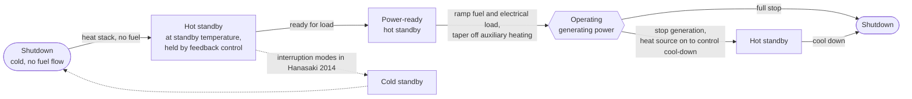

# SOFC Operational-Stage Terminology: Literature Notes

**Question:** Is there any paper on SOFC systems for data center use that defines terminology for operational stages?

**Short answer:** No single paper found. The closest vocabulary comes from patents and a durability paper that are not data-center-specific. Data-center papers focus on load following and reliability, not on stage definitions. Nothing found defines *trip*, *hot idle* or a standard *cold start*.

---

## 1. Stage flowchart (LG patent family vocabulary)

Reading the chart:

- **Solid arrows** are the transitions described in the LG Electronics patents.
- **Dotted arrows** show where Hanasaki et al. (2014) add *cold standby* as a third interruption mode between hot standby and shutdown.

## 2. Terms and how each source defines them (verified against full text)

Verified 2026-10-20 by reading Hanasaki 2014 in full and the LG (US10797329) and Toto (US8501358, US8497044) patents on Google Patents. The two Toto patents were read only up to character 100,000 of the page text, so late passages were not seen. LG US10622649 was not re-read.

| Term | Definition in the source | Source |
|---|---|---|
| Shut-down mode | System not operating, at ambient temperature; oxidant may flow, no fuel | LG US10797329 |
| Hot standby mode | Stack at about 800–1000 °C; oxidant flows to hold temperature; no SOFC fuel to the anodes | LG US10797329 |
| Power-ready hot standby | Stack at hot standby temperature with SOFC fuel flow of 1–5 % of full-load mass flow | LG US10797329 |
| Normal operating mode | Stack at about 800–1000 °C, oxidant and SOFC fuel supplied, generating power | LG US10797329 |
| Hot standby (protocol) | Residential system cooled to 600 °C during idle periods, small amount of electricity still generated, fuel supply never interrupted | Hanasaki 2014 |
| Cold standby (protocol) | Controlled stop, natural cool-down to 200 °C for longer absences; diluted H2 during cool/heat steps | Hanasaki 2014 |
| Shutdown (protocol) | Emergency shutdown (blackout, earthquake): fuel supply shuts off, temperature changes very quickly | Hanasaki 2014 |
| Startup mode operation | Reformer runs POX → ATR → SR while cells heat to the generation startup temperature | Toto US8501358 |
| Generating mode operation | Starts when the electrical-generation startup temperature is exceeded; startup mode ends | Toto US8501358 |
| Load-following operation | Fuel, air and water flows adjusted to match power demanded from the inverter | Toto US8497044 (also named in US8501358) |
| Shutdown (operation) | Fuel and steam reduced first; generating air keeps cooling until set temperatures are reached | Toto US8497044 |
| Cold start, hot idle, trip | **Not found in any source read** | none |

Cautions:

- "Hot standby" means **different things** in LG (800–1000 °C, no fuel) and Hanasaki (600 °C, still generating a little power). Do not treat them as one stage.
- "Shutdown" in Hanasaki is an **emergency** event, which is closer to a trip than to LG's ambient-temperature shut-down mode.

### 2b. Where each stage name is defined (source matrix)

✔ = the source names and defines the stage. – = not found in the text read. "?" = not checked.

| Stage name | LG US10797329 | Hanasaki 2014 | Toto US8501358 / US8497044 | Data-center papers (arXiv 1806.04506, JQME 2020, MS 2014) | IEC 62282 |
|---|---|---|---|---|---|
| Shutdown | ✔ ambient, no fuel | ✔ emergency shutdown protocol | ✔ shutdown operation (8497044 only) | – none defined | ? |
| Cold standby | – | ✔ 200 °C hold, controlled stop | – | – none defined | ? |
| Hot standby | ✔ 800–1000 °C, no fuel | ✔ 600 °C, small power generated | – | – none defined | ? |
| Power-ready hot standby | ✔ 1–5 % fuel flow | – | – | – none defined | ? |
| Startup / heat-up | – (named only in passing) | – | ✔ startup mode operation (POX → ATR → SR) | – none defined | ? |
| Operating / generating | ✔ normal operating mode | – | ✔ generating mode operation | – none defined | ? |
| Load following | – | – | ✔ load-following operation | ✔ as a measured ramp rate (arXiv, MS), not a stage | ? |
| Cold start | – | – | – | – none defined | ? |
| Hot idle | – | – | – | – none defined | ? |
| Trip (protective state) | – | – (closest: emergency shutdown) | – | – none defined | ? |

Takeaways:

- **Shutdown and hot standby** are the only names defined by more than one source, and the two hot standby definitions conflict.
- **Power-ready hot standby** appears only in the LG patent, and it is the only stage defined by a numeric fuel-flow range (1–5 % of full load).
- **Startup, generating and load-following** come only from the Toto patents. Toto does not use "hot standby" or "cold standby" anywhere.
- **Cold standby** appears only in Hanasaki 2014.
- **Cold start, hot idle and trip** were not found. If your S0–S8 stages use these names, they likely come from vendor or plant documentation.
- **None of the three data-center papers defines an operating-stage vocabulary** (see 2c). The "– none defined" cells in that column are verified. Only load following and startup/shutdown are mentioned, and not as defined stages.
- IEC 62282 was not opened, so that column is still unconfirmed.

### 2c. What the data-center papers actually contain

Read: arXiv 1806.04506 (full text, 15 pages), Microsoft ES FuelCell2014 (full text, 8 pages), JQME 2020 (abstract and metadata page only; the full text was not accessible).

| Paper | Fuel cell type | Stage-related content | Defines stages? |
|---|---|---|---|
| arXiv 1806.04506, power surges in fuel-cell data centers | Experimental 12.5 kW system with load following; proton exchange membrane context, SOFC only in references | Defines **load following rate** (slope at which output can rise without shortfall); test profile of ramp up / hold / ramp down. No startup, standby, shutdown or trip. | No |
| Microsoft ES FuelCell2014 | **PEMFC** (47 mentions; SOFC only in the background text) | Step-load response (3.2 s to ramp for a 4.5 → 9 kW step), battery/UPS bridging, and a remark that servers cause large load changes only during startup or shutdown of the *servers*. | No |
| JQME 2020, multi-stack SOFC reliability | SOFC | Abstract mentions "start-up and normal operation" and "complete shutdown" when too few stacks run; neither is defined. Full text not read. | No (abstract only) |

Takeaways:

- The two measured data-center papers use **PEM-type** fuel cells, so they are weak evidence for SOFC stage names anyway.
- In these papers "startup/shutdown" mostly refers to **servers**, not the fuel cell.

### 2d. Bloom Energy

Checked 2026-10-20: the Bloom load-following whitepaper (full text, 13 pages) and Bloom patent US7846599B2 (first 100,000 of 150,831 characters). Broader Bloom patent and manual searches returned only titles and snippets.

| Source | Stage names found | Defined how |
|---|---|---|
| [Bloom, "Load Following Solid Oxide Fuel Cell" whitepaper (Feb 2024)](https://www.bloomenergy.com/wp-content/uploads/load-following-solid-oxide-fuel-cell.pdf) | **None.** No startup, standby, idle, trip, cold start or hot box. It covers ramping, part-load efficiency (40 % to 100 % step loads with supercapacitor support) and economics. | Not a stage document |
| [Bloom patent US7846599B2](https://patents.google.com/patent/US7846599B2/en), "Method for high temperature fuel cell system start up and shutdown" | **Start up operating mode**, **steady state operating mode**, **shut down operating mode** | Start up: main stack has not yet reached operating conditions such as temperature. Steady state: desired conditions achieved. Shut down: "while it cools down" after the system stops. |
| Same patent, PEM auxiliary stack | **Hydrogen pumping (electrolysis) mode** and **fuel cell (power generating) mode** | Describes the PEM helper stack, not the SOFC stack's own stages |

Findings:

- Bloom publishes no stage vocabulary that I could find. The only definitions are the three-mode startup / steady state / shutdown set in the one patent.
- The patent does not use "standby", "hot standby", "cold start", "idle" or "trip".
- A search also surfaced US20100151288 ("standby/regenerative mode", plus an idle mode), but its assignee is **GM** and it covers a PEM vehicle fuel cell. It is not a Bloom source and does not apply to SOFC.
- Not read: Bloom's Energy Server operations manuals and safety data sheets. They are the most likely place for fault, trip and standby wording. They need a Bloom customer login, so I could not retrieve them.
- Not opened: a Bloom filing on microgrid power management when distributed energy resources transition between operating modes. Its title suggests relevance, but I saw only a listing.

### Corrections to the earlier version of this file

- The earlier table said Hanasaki's hot standby was "held near operating temperature". It is a 600 °C idle state.
- The earlier table said the Toto patents define a "standby mode" and a "200 W/min" ramp. Neither was found in the full text. Those claims came from search snippets.

## 3. Sources by relevance

### Stage terminology (not data-center-specific)

- LG Electronics patent family, "Methods for transitioning a fuel cell system between modes of operation": [10797329](https://patents.justia.com/patent/10797329), [10622649](https://image-ppubs.uspto.gov/dirsearch-public/print/downloadPdf/10622649).
- Hanasaki et al., J. Electrochem. Soc. 2014, "SOFC durability against standby and shutdown": [PDF](https://strathprints.strath.ac.uk/85587/1/Hanasaki_etal_JES_2014_SOFC_durability_against_standby_and_shutdown.pdf). It is a durability paper, not a state-definition paper.
- IEC 62282 (fuel cell technologies) is the standards family to check for formal terms. **Not verified** to use these exact words.

### Data-center-specific

- [Techniques for Efficiently Handling Power Surges in Fuel Cell Powered Data Centers](https://arxiv.org/pdf/1806.04506) (arXiv 1806.04506). Slow load following causes server power surges. It is not about operating stages.
- [Microsoft Research, ES FuelCell2014](https://microsoft.com/en-us/research/wp-content/uploads/2014/06/ES-FuelCell2014.pdf). Fuel-cell-powered data center design.
- [Reliability analysis for a multi-stack SOFC system](https://emerald.com/insight/content/doi/10.1108/JQME-04-2020-0021/full/html) (JQME, 2020). Multi-stack SOFC reliability is not sufficient for a sole power source in critical loads such as data centers.
- DOE / NETL slides (not papers): [NETL SOFC presentation](https://netl.doe.gov/sites/default/files/netl-file/24FECM_SOFC_Connors.pdf) on grid-tied versus off-grid operation and the need for batteries; [2019 DOE data center workshop](https://www.energy.gov/sites/prod/files/2019/04/f62/fcto-data-center-workshop-2019-brouwer.pdf).

### Vendor material (marketing, not definitions)

- [Bloom load-following whitepaper](https://www.bloomenergy.com/wp-content/uploads/load-following-solid-oxide-fuel-cell.pdf) and [Bloom patent US7846599B2](https://patents.google.com/patent/US7846599B2/en); see section 2d.
- [DCD on Bloom Energy load following](https://www.datacenterdynamics.com/en/news/bloom-energy-adds-variable-load-ability-to-its-fuel-cells).

## 4. Gaps and next steps

- No source defines **trip**, **hot idle** or a standard **cold start**. Vendor control manuals are probably the best source for a full stage list such as S0–S8.
- Suggested next steps:
  1. Run a deeper Google Scholar / IEEE search, e.g. "SOFC hybrid battery data center transient".
  2. Map the project's S0–S8 stages onto the LG and Hanasaki terms.
  3. Check IEC 62282 for formal state names.
